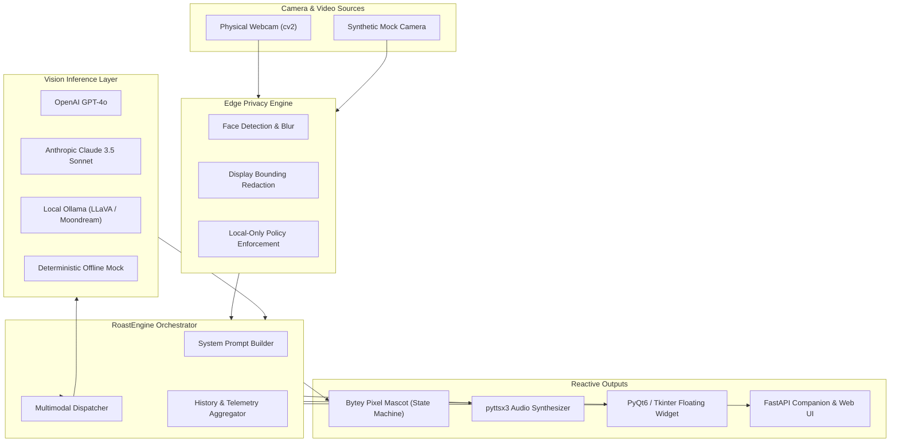

# 🤖 RoastBot-Vision: Real-Time Multimodal Vision Sidekick & Desk Critic

[](https://github.com/Manansur108/roastbot-vision/actions/workflows/ci.yml)
[](https://www.python.org/)
[](https://opensource.org/licenses/MIT)
[](https://fastapi.tiangolo.com)
[](https://www.riverbankcomputing.com/software/pyqt/)
[](https://opencv.org/)

> **A standalone lightweight desktop companion with an expressive animated pixel mascot that uses real-time webcam feeds and multimodal vision models to roast your desk clutter, track your posture, rate your outfit, celebrate when you drink water, and provide hilarious running audio commentary on your coding sessions.**

---

```
             .  .@@@@.  .
            .  .@@..@@.  .
               .@@..@@.
            ....@@@@@@....
           .@@@@@@@@@@@@@@.
          .@@  o      o  @@.    "I analyzed your cable management.
          .@@     __     @@.     Did you hire a family of raccoons
          .@@@@@@@@@@@@@@@@.     to wire your desk?"
           .@@@@@@@@@@@@@@.
                ..@@..
               .******.
              .********.
```

---

## 🌟 Key Highlights

- **🧠 Pluggable Multimodal Vision**: Native connectors for **OpenAI GPT-4o**, **Anthropic Claude 3.5 Sonnet**, local **Ollama (LLaVA / Moondream2)**, and an offline **MockVisionProvider** that runs with zero API keys required!
- **⚡ 4 Roast Severity Levels**:
  - `Gentle Ribbing`: Affectionate workplace banter and friendly encouragement.
  - `Snarky Dev`: Sarcastic Senior Engineer roasting your git blame and CSS flexbox.
  - `Savage Mode`: Razor-sharp standup comedy burns with zero filter.
  - `Gordon Ramsay`: Kitchen Nightmares energy—LOUD, APOMPLEXIC RAGE (*"WHAT ARE YOU? AN IDIOT SANDWICH WITH A MECHANICAL KEYBOARD?!"*).
- **🎯 7 Evaluation Modes**:
  - `DESK_CLUTTER`: Analyzes cables, dishes, wrappers, and clutter density.
  - `POSTURE_CHECK`: Detects shrimp/hunchback spine angles and ergonomic slouching.
  - `DRIP_CHECK`: Rates oversized hackathon hoodies and developer couture.
  - `HYDRATION_HERO`: Identifies water glasses/bottles and throws a triumphant celebration party!
  - `CODE_ROAST`: Roasts compiler errors, terminal doom, and uncommitted git diffs.
  - `CAFFEINE_RADAR`: Counts empty mug graveyards and predicts caffeine crash time.
  - `GENERAL_ROAST`: Ambient workspace critic.
- **🛡️ Edge Camera Privacy Engine**:
  - Automatic Haar-cascade face detection with **Gaussian blur redaction** before frames leave your machine.
  - Screen blackout masking to ensure proprietary code and chat tabs are never sent to remote models.
  - Local-Only Mode guarantees frames never touch the cloud.
- **👾 Animated Pixel Mascot ("Bytey")**:
  - Procedural 24×24 CRT sentry bot generated at runtime in code (no external image assets required).
  - 7 Reactive Emotional States: `IDLE`, `THINKING`, `SNARKY`, `SHOCKED`, `CELEBRATING`, `ROASTING`, `SLEEPING`.
  - Multi-target renderers: RGBA PIL Image, ANSI Terminal ASCII, and SVG vector.
- **🔊 Speech Synthesis Commentary**: Spoken audio roasts powered by non-blocking queueing with mute control.
- **🖥️ Dual Desktop Companion Options**:
  - **PyQt6 Floating Overlay**: Frameless, transparent, draggable, always-on-top mascot widget with comic speech bubble.
  - **Tkinter Fallback**: Lightweight pure-Python overlay for systems without Qt.
  - **FastAPI Web Companion**: Real-time browser companion dashboard with live canvas mascot, camera preview, and REST/WebSocket API.

---

## 📐 Architecture Overview



---

## 🚀 Installation & Quick Start

### 1. Clone & Install

```bash
git clone https://github.com/Manansur108/roastbot-vision.git
cd roastbot-vision

# Install package and dependencies
pip install -e ".[gui,dev]"
```

### 2. Instant One-Line Terminal Roast

```bash
# Capture a frame right now and print humorous feedback:
roastbot roast --category desk_clutter --severity snarky

# Try Gordon Ramsay mode:
roastbot roast --category posture_check --severity gordon_ramsay
```

### 3. Launch the Floating Desktop Mascot Overlay

```bash
# Launch transparent always-on-top desktop companion:
roastbot overlay

# Or run with lightweight Tkinter fallback:
roastbot overlay --tk
```

### 4. Launch the Web Companion Dashboard

```bash
roastbot serve --port 8420
```
Open **http://127.0.0.1:8420** in your browser to interact with Bytey, view real-time privacy previews, and trigger roasts.

---

## 💻 CLI Command Reference

| Command | Arguments | Description |
|---|---|---|
| `roastbot roast` | `--category`, `--severity`, `--privacy`, `--mute`, `--mock-cam` | Instantaneous camera capture, multimodal inference, and roast |
| `roastbot overlay` | `--tk`, `--mock-cam` | Launch floating transparent always-on-top desktop mascot widget |
| `roastbot serve` | `--host`, `--port`, `--mock-cam` | Run FastAPI web companion server with live HTML5 canvas |
| `roastbot mascot` | None | Display terminal ASCII showcase of all Bytey expressions |
| `roastbot demo` | None | Run simulated showcase of multiple categories and severity levels |

---

## ⚙️ Configuration & Environment Variables

You can configure RoastBot via CLI arguments or environment variables:

| Environment Variable | Options / Default | Description |
|---|---|---|
| `OPENAI_API_KEY` | `sk-...` (Optional) | Activates GPT-4o vision inference |
| `ANTHROPIC_API_KEY` | `sk-ant-...` (Optional) | Activates Claude 3.5 Sonnet vision inference |
| `OLLAMA_BASE_URL` | `http://localhost:11434` | Endpoint for local vision models |
| `OLLAMA_MODEL` | `llava:latest` or `moondream:latest` | Multimodal model tag in Ollama |
| `ROASTBOT_SEVERITY` | `gentle`, `snarky`, `savage`, `gordon_ramsay` | Default roast severity intensity |
| `ROASTBOT_CATEGORY` | `desk_clutter`, `posture_check`, `drip_check`, `hydration_hero`, `code_roast`, `caffeine_radar`, `general_roast` | Default target category |
| `ROASTBOT_PRIVACY` | `blur_faces`, `redact_screens`, `normal`, `local_only` | Edge camera privacy filter |
| `ROASTBOT_SPEECH` | `true` / `false` | Enable or mute text-to-speech engine |
| `ROASTBOT_MOCK_CAMERA` | `true` / `false` | Use procedural synthetic test camera |

---

## 📡 REST & WebSocket API Specification

When running `roastbot serve`, the companion backend exposes clean REST endpoints:

- **`POST /api/roast`**: Triggers immediate snapshot and returns critique JSON:
  ```json
  {
    "roast": "Your cable management looks like an O(N!) algorithm implemented in copper wire.",
    "score": 34,
    "emotion": "snarky",
    "category": "desk_clutter",
    "severity": "snarky",
    "detected_items": ["wire nest", "dust bunny", "3 empty mugs"],
    "is_celebration": false,
    "provider_name": "mock"
  }
  ```
- **`GET /api/mascot/state`**: Live emotion, dialog, mood score, and animation ticker.
- **`GET /api/mascot/sprite?emotion=shocked&scale=8`**: Returns procedural PNG sprite.
- **`GET /api/camera/preview`**: Returns JPEG preview with active privacy redactions applied.
- **`POST /api/speech/toggle`**: Toggles voice narration.
- **`WebSocket /ws/mascot`**: Real-time push feed for connected overlays and external displays.

---

## 🧪 Testing

The test suite contains **40 comprehensive unit tests** covering all modules:

```bash
pytest -v
```

```
======================== 40 passed in 3.07s ========================
```

---

## 📜 License

MIT License © 2026 Manan Sur. See [LICENSE](LICENSE) for details.
